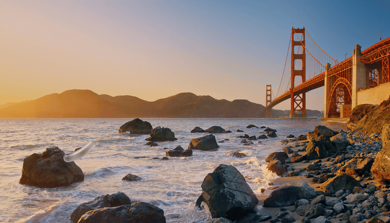

# Liquid Glass Renderer

An independent offscreen renderer for Linux with a Rust library, a Python package, and shared GLSL shaders. The host application supplies backdrop pixels, layers, and material parameters. The renderer refracts and filters the backdrop through the glass shapes and returns a composited image.

The renderer was built by reverse-engineering a macOS system image and uses the original material and animation values recovered for the rendering paths that have been verified.

## Renderer in action

### Glass morphing


### Handwritten hello



An independently drawn greeting over the Golden Gate Bridge. This preview models the lettering as a 3D glass volume and uses the angle-dependent refraction, RGB dispersion, and wipe timing recovered from the macOS Setup Assistant. The lighting and two-second write-in are specific to this preview.

### Elastic drag and release


The demo magnifies the deformation and slows the release so the spring motion is easy to see.

### Quickshell widgets

Calendar and clock widgets from the live Quickshell integration on Hyprland. All previews use the Golden Gate backdrop.

| Calendar | Digital clock |
| --- | --- |
|  |  |

## Installation and quick start

You need Linux, EGL, and an OpenGL 4.5 driver. Mesa's llvmpipe software renderer also works. For Rust, install a linker and the EGL and GL development libraries, such as `libegl-dev` and `libgl-dev` on Debian or Ubuntu. The Rust build was tested with Rust 1.99. The Python package requires Python 3.10+, NumPy, and Pillow.

### Rust

```sh
cargo build --release --manifest-path rust/glass-core/Cargo.toml
mkdir -p out
cargo run --release --manifest-path rust/glass-core/Cargo.toml --example pass -- out/rust-glass.ppm
```

The example renders two overlapping glass shapes and updates part of the backdrop. Use `Renderer`, `Frame`, `SdrRecipe`, and `LiveScene` from the `liquid_glass_core` crate to integrate the renderer into your application.

### Python

```sh
python3 -m venv .venv
. .venv/bin/activate
python -m pip install .
python -m liquid_glass --output out/python-glass.png
```

Build custom scenes with `SceneRenderer`, `Element`, and `Material`. The Python package takes explicit material values. Images are arrays of shape `(height, width, 4)`. The compositor defaults to linear, premultiplied RGBA.

## Feature checklist

- [x] Offscreen EGL/OpenGL rendering with shared GLSL passes
- [x] Distance fields from geometry or rasters, with smooth unions of multiple shapes
- [x] Refraction, chromatic aberration, blur mip pyramids, and backdrop composition
- [x] Edge highlights, edge color bleed, and shadows in the corresponding material passes
- [x] Ordered glass groups that sample either the original backdrop or the composited result
- [x] Spring animations that can be retargeted while in motion
- [x] Rust SDR material recipes for Clear, Regular, Dock, and Popover with diffusion and tint
- [x] Rust interaction effects for hover, press, and localized glow
- [x] Rust partial backdrop updates and GPU resource reuse
- [ ] General automatic material and shape matching as in the macOS compositor
- [ ] Full visual parity with Apple's native output across graphics drivers

The repository includes runnable renderers and synthetic examples.
