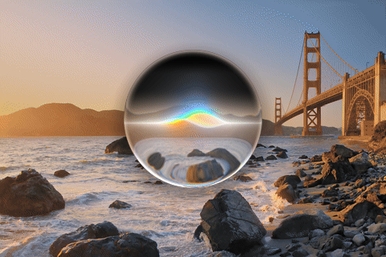
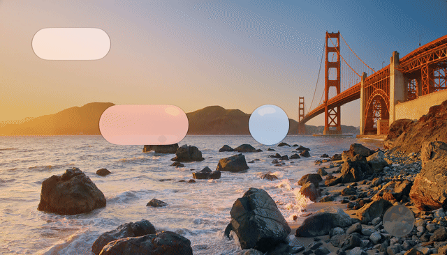
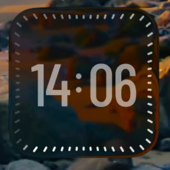

# Liquid Glass Renderer

An independent offscreen renderer for Linux with a Rust library, a Python package, and shared GLSL shaders. The host application supplies backdrop pixels, layers, and material parameters. The renderer refracts and filters the backdrop through the glass shapes and returns a composited image.

The renderer was built by reverse-engineering a macOS system image and uses the original material and animation values recovered for the rendering paths that have been verified.

## Renderer in action

### Glass morphing


### Multilingual hello


A glass Apple logo morphs into “hello,” followed by all 49 localized Hello variants bundled with macOS 27.2 and the English “Welcome.” The preview uses the Setup Assistant’s Macintosh Skeletal lettering and recovered optical parameters. The Golden Gate scene, logo transition, and pacing of the language rotation are specific to this preview.

### Siri orb



Renders the recovered macOS 27.2 (`26B123`) `SiriEffect` shaders (`shaders/siri-effect.frag`: 4× RGSS MSAA chromatic light ribbon and 6-pair fluid metaball thinking dots) inside a circular Liquid Glass orb with a glossy dark upper dome transitioning smoothly into crystal-clear optical refraction below.

### Automatic material and shape matching



Demonstrates `matching::GlassContainer`: proximate compatible shapes automatically unite into shared `sdfUnion` batches with per-shape tagged tints, arriving and departing controls without an explicit `match_id` automatically match neighbors via `26A434` `CGRect.minDistance` (`FRINTA` pixel rounding, directed factor-3 size gate, and `hasCloseElement` chains) to emerge and pinch off organically, explicit `match_id` pairs transfer live 300 Hz spring state across IDs, incompatible roles (`Clear` over `Regular`) stay in separate contiguous Z-chunks, and `adaptive` surfaces smoothly interpolate between `Light` and `Dark` glass via `Animation.default` (`FluidSpring(0.50, 1.00)`).

> **Adapter boundary & extension beyond live macOS:** Because `liquid_glass_core` operates on flat caller-supplied rectangles without a SwiftUI `AttributeGraph` / `DisplayList` runtime, newly split shapes compute their tucked start frame geometrically inside the matched partner's facing rim rather than reading a SwiftUI `GeometryProxy` anchor, and `Light`↔`Dark` transitions interpolate the resolved 320-byte uniform buffer and `binary16` color matrices directly rather than scheduling separate CoreAnimation layer transactions. In addition, whereas a native macOS `GlassEffectContainer` shares one `BackdropState` across the whole container, `GlassContainer` intentionally extends this so surfaces in the same `group_id` can adapt independently (`Light` vs. `Dark`) in separate passes and dynamically unite into a shared `sdfUnion` once their `dark_mix` converges (`<= 0.005`).

### Elastic drag and release


The demo magnifies the deformation and slows the release so the spring motion is easy to see.

### Quickshell widgets

Calendar and clock widgets from the live Quickshell integration on Hyprland. All previews use the Golden Gate backdrop.

| Calendar | Digital clock |
| --- | --- |
|  |  |

## Choosing an entry point

You do not need to read any reverse-engineering internals to build with this renderer:

1. **Rust applications & creative tools (e.g. an Icon Composer):**
   Use the `liquid_glass_core` crate (`Renderer`, `Frame`, `SdrRecipe`, `RecipeRole::AppIcons`, `LiveScene`, `matching::GlassContainer`) to composite real-time Liquid Glass layers over your own canvas or render directly to RGBA buffers for PNG export.
2. **Python scripts & prototypes:**
   Use the `liquid_glass` package (`SceneRenderer`, `Element`, `Material`) for offscreen image and animation rendering with NumPy arrays.
3. **Shared GLSL shaders:**
   The `shaders/` directory contains the standalone GLSL 450 passes (including `siri-effect.frag` for the 26B123 chromatic light wave and fluid thinking dots) for integration into any OpenGL/Vulkan/wgpu host.

## Installation and quick start

You need Linux, EGL, and an OpenGL 4.5 driver. Mesa's llvmpipe software renderer also works. For Rust, install a linker and the EGL and GL development libraries, such as `libegl-dev` and `libgl-dev` on Debian or Ubuntu. The Rust build was tested with Rust 1.99. The Python package requires Python 3.10+, NumPy, and Pillow.

### Rust

```sh
cargo build --release --manifest-path rust/glass-core/Cargo.toml
mkdir -p out
cargo run --release --manifest-path rust/glass-core/Cargo.toml --example pass -- out/rust-glass.ppm
```

The example renders two overlapping glass shapes and updates part of the backdrop. Use `Renderer`, `Frame`, `SdrRecipe`, and `LiveScene` from the `liquid_glass_core` crate to integrate the renderer into your application.

### Python

```sh
python3 -m venv .venv
. .venv/bin/activate
python -m pip install .
python -m liquid_glass --output out/python-glass.png
```

Build custom scenes with `SceneRenderer`, `Element`, and `Material`. The Python package takes explicit material values. Images are arrays of shape `(height, width, 4)`. The compositor defaults to linear, premultiplied RGBA.

## Feature checklist

- [x] Offscreen EGL/OpenGL rendering with shared GLSL passes
- [x] Distance fields from geometry or rasters, with smooth unions of multiple shapes
- [x] Refraction, chromatic aberration, blur mip pyramids, and backdrop composition
- [x] Edge highlights, edge color bleed, and shadows in the corresponding material passes
- [x] Ordered glass groups that sample either the original backdrop or the composited result
- [x] Spring animations that can be retargeted while in motion
- [x] Rust SDR material recipes for Clear, Regular, Dock, Popover, and AppIcons with diffusion and tint
- [x] `26B123` `SiriEffect` GLSL port (`shaders/siri-effect.frag`: 4× RGSS MSAA chromatic wave + 6-pair fluid metaball dots)
- [x] Rust interaction effects for hover, press, and localized glow
- [x] Rust partial backdrop updates and GPU resource reuse
- [x] Automatic material and shape matching (`matching::GlassContainer`: cross-ID `match_id` spring morphing, automatic `sdfUnion` grouping, and backdrop luminance adaptation)
- [ ] Full visual parity with Apple's native output across graphics drivers

The repository includes runnable renderers and synthetic examples.
